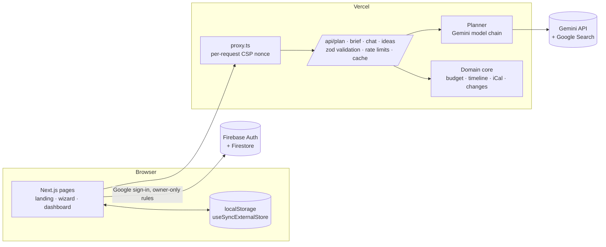

# UtsavOS

**An AI celebration planner for weddings, birthdays and community events.** Describe your celebration in one sentence, in English, Hindi, Hinglish or eight other Indian languages, and UtsavOS uses Google Gemini to draft the **budget**, **timeline**, **vendor checklist** and **personalized ideas**. A co-planner then refines the plan with you, and nothing changes until you approve it.

**Live app: https://utsav-os-teal.vercel.app**

[](https://github.com/Harsha-code-per/UtsavOS/actions/workflows/ci.yml)

Built for PromptWars Virtual, Challenge 5: Celebration & Event Planner.

---

## The challenge, feature by feature

> _Create a GenAI-powered planning assistant that helps users organize weddings, birthdays, and community events with budgets, timelines, vendor checklists, and personalized ideas._

| Requirement                                           | What UtsavOS does                                                                                                                                                        | Where                                                                                                                                        |
| ----------------------------------------------------- | ------------------------------------------------------------------------------------------------------------------------------------------------------------------------ | -------------------------------------------------------------------------------------------------------------------------------------------- |
| Weddings, birthdays, community events (and festivals) | A brief wizard with per-type traditions (haldi, sangeet, cake cutting, pandal setup…), or a one-sentence AI quick-fill                                                   | [`BriefWizard.tsx`](src/components/brief/BriefWizard.tsx), [`/api/brief`](src/app/api/brief/route.ts)                                        |
| **Budgets**                                           | Gemini proposes a category split; code allocates exact whole amounts. Log payments, see overruns at once, and ask the co-planner to rebalance                            | [`budget.ts`](src/lib/domain/budget.ts), [`BudgetPanel.tsx`](src/components/plan/BudgetPanel.tsx)                                            |
| **Timelines**                                         | Milestones counted back from the event date, plus a run sheet for the day. Export to Google Calendar (`.ics` or one-click links)                                         | [`timeline.ts`](src/lib/domain/timeline.ts), [`ics.ts`](src/lib/domain/ics.ts), [`TimelinePanel.tsx`](src/components/plan/TimelinePanel.tsx) |
| **Vendor checklists**                                 | Every vendor category, tracked from to-do to booked with quotes, plus questions to ask before paying an advance                                                          | [`VendorsPanel.tsx`](src/components/plan/VendorsPanel.tsx)                                                                                   |
| **Personalized ideas**                                | Themes, decor, menus, activities and gifts tuned to culture, city, vibe, diet and budget. Fresh local ideas come from Gemini with Google Search grounding, sources cited | [`IdeasPanel.tsx`](src/components/plan/IdeasPanel.tsx), [`/api/ideas`](src/app/api/ideas/route.ts)                                           |
| Planning assistant                                    | A co-planner chat that **edits the plan** through Gemini function calling. Every proposed change is shown in plain words and applied only on approval                    | [`CoPlanner.tsx`](src/components/plan/CoPlanner.tsx), [`tools.ts`](src/lib/ai/tools.ts)                                                      |

## How Generative AI is used

| Feature          | Gemini capability                                                                                                                     | Implementation                                         |
| ---------------- | ------------------------------------------------------------------------------------------------------------------------------------- | ------------------------------------------------------ |
| Full plan draft  | Structured output (`responseJsonSchema` generated from the same zod schema the app validates with)                                    | [`planner.ts`](src/lib/ai/planner.ts) → `draftPlan`    |
| Brief quick-fill | Structured extraction from free text in any language, including "1.5 lakh" → 150000 and "next February" → a date                      | `parseBrief`, [`prompts.ts`](src/lib/ai/prompts.ts)    |
| Co-planner       | Function calling: 7 typed tools (`moveBudget`, `addMilestone`, `setVendorStatus`…) declared from zod schemas                          | [`tools.ts`](src/lib/ai/tools.ts) → `chat`             |
| Local ideas      | Grounding with Google Search with cited sources, falling back to schema-constrained ideas when the free-tier grounding quota runs out | `ideas`                                                |
| Multilingual     | Plans and replies in 10 languages; browser speech input in the plan's language                                                        | `LANGUAGES` in [`schema.ts`](src/lib/domain/schema.ts) |

**Principle: Gemini proposes, code guarantees.** The model returns _intent_: percentage splits, "N days before" offsets, proposed changes. Pure, tested code turns that into the plan: budgets always add up to exactly the total, dates never fall in the past or after the event, and a change that can't apply is never shown. Model output is treated as untrusted. [`sanitizeDraft`](src/lib/domain/plan.ts) keeps every valid item and drops the rest, and [`applyChange`](src/lib/domain/plan.ts) re-validates the whole plan after each edit.

**Resilience.** Requests go through a model chain (Gemini 3.8 Flash → Gemini Flash-Lite, both with low thinking for speed) that moves to the next model on overload, quota or timeout, within a 50-second budget. If Gemini is unavailable, `/api/plan` still returns a complete starter plan from curated templates, and the dashboard offers to redraft with Gemini later. Identical requests are cached for 30 minutes to save quota.

## Google services

- **Gemini API** (`@google/genai`): structured output, function calling, Google Search grounding
- **Firebase Authentication**: Google sign-in to sync plans across devices
- **Cloud Firestore**: per-user plan storage behind owner-only, shape-validating [security rules](firestore.rules)
- **Google Calendar**: `.ics` export and one-click "add to Google Calendar" links
- **Google Fonts** via `next/font` (Rozha One and Mukta, both with Devanagari), self-hosted at build time

## Architecture



```
src/
  app/                 routes: landing, (app)/plan/new, (app)/plan/[id], (app)/plans, api/*
  components/          brand (toran, logo), landing, brief wizard, plan dashboard panels
  lib/domain/          pure, framework-free logic: schema, budget, timeline, ics, plan, format
  lib/ai/              planner facade, Gemini adapter (model chain), mock, prompts, tools, output guards
  lib/api/             shared route guard, HTTP helpers, TTL cache, typed browser client
  lib/security/        CSP builder, rate limiter
  lib/store/           local + Firestore persistence, React hooks
  proxy.ts             nonce-based Content-Security-Policy
e2e/                   Playwright flows, axe accessibility audits, security checks
rules/                 Firestore security-rules tests (emulator)
```

### Design decisions

- **Gemini proposes, code guarantees.** Gemini returns percentages and lead times. Code turns them into exact amounts that add up to the budget and real dates before the event, so the maths is never the model's job.
- **The person approves every AI edit.** The co-planner's function calls become typed `PlanChange`s. The server drops any change that wouldn't apply, and the rest wait for an Apply click.
- **Local first, synced when signed in.** Plans save to the device instantly and work without an account. Signing in with Google syncs them through Firestore, keeping the newest copy of each.
- **Planning never dead-ends.** A model chain with a time budget falls back from Gemini 3.8 Flash to Flash-Lite, then to a hand-written starter plan that can be redrafted later.
- **Nonce CSP over static pages.** Every page is rendered per request so it can carry a fresh script nonce. Strict CSP without `unsafe-inline` was worth more here than CDN caching of the HTML.

See [CONTRIBUTING.md](CONTRIBUTING.md) for layer rules and conventions.

## Security

Defence in depth, detailed in [SECURITY.md](SECURITY.md):

- The Gemini key lives only on the server. Firebase web config is public by design, and access is enforced by [Firestore rules](firestore.rules).
- **Strict CSP**: a per-request nonce with `strict-dynamic`, no `unsafe-inline` in production, `frame-ancestors 'none'`. Plus HSTS, `nosniff`, `Referrer-Policy` and `Permissions-Policy`.
- Every API body is checked for content type and size, then validated with zod. There are per-client rate limits, and error messages never leak internals.
- **Prompt-injection hardening**: user data is fenced in escaped tags, model output is schema-validated, and tool calls are allow-listed, re-validated against the plan, and applied only after the person approves.
- Firestore rules: owner-only access, exact key set and type checks, everything else denied. Tested on the emulator.
- `npm audit --omit=dev` reports 0 vulnerabilities, and CI checks it on every push.

## Accessibility

- WCAG 2.2 AA verified with **axe-core on every page and every dashboard tab**, on desktop and mobile, in CI.
- Semantic landmarks, a skip link, visible focus, and labelled inputs with inline errors linked through `aria-describedby`. Focus moves to the first invalid field.
- WAI-ARIA tabs with roving tabindex. Native radios, `<dialog>` and `<details>` for built-in keyboard support.
- `aria-live` regions for co-planner replies, save state and AI progress. `lang` is set on Hindi and other Indic text.
- `prefers-reduced-motion` respected. Every animation has a static end state and the page is complete without JavaScript animation.
- Colour is never the only signal: overruns, statuses and due dates are always stated in text. Touch targets are at least 44px.

## Efficiency

Lighthouse on the live site scores **100** for Accessibility, Best Practices and SEO on both desktop and mobile, with 0 failed audits. A performance trace shows **LCP 507 ms** and **CLS 0.00**.

- Firebase, GSAP and Lenis are **lazy-loaded** with dynamic `import()`. The landing page never downloads Firebase.
- The landing load sequence is pure CSS, with no JavaScript gate or layout shift. Fonts are self-hosted with `next/font`.
- Budget, timeline and calendar maths run locally and instantly. Only drafting, chat and ideas call Gemini.
- A 30-minute cache for identical AI requests, plus a model chain with a hard time budget.

## Testing

| Suite                                         | Command                         | Covers                                                                                                                           |
| --------------------------------------------- | ------------------------------- | -------------------------------------------------------------------------------------------------------------------------------- |
| Unit and component (Vitest + Testing Library) | `npm test` / `npm run coverage` | domain logic, AI adapter with a fake model, API routes (success, invalid input, rate limit, model failure, cache), UI components |
| Firestore rules (emulator)                    | `npm run test:rules`            | owner-only access, cross-user denial, malformed documents                                                                        |
| End-to-end (Playwright, desktop + Pixel 7)    | `npm run test:e2e`              | brief → plan → overspend → approved fix → calendar export; persistence; axe audits; CSP and header checks                        |

CI ([`.github/workflows/ci.yml`](.github/workflows/ci.yml)) runs four parallel jobs on every push and pull request: static checks (`npm audit`, Prettier, ESLint, types), unit tests with coverage, rules tests, and the end-to-end suite. Coverage and Playwright reports are uploaded as artifacts, and Dependabot keeps dependencies and actions current.

## Code quality

- **Strict TypeScript and lint.** `strict` plus `noUncheckedIndexedAccess`. ESLint uses typescript-eslint's `strictTypeChecked` and `stylisticTypeChecked` presets on all application code, with zero warnings allowed.
- **Size and complexity budgets, enforced in CI.** At most 250 lines per file, 80 lines per function, cyclomatic complexity 10, nesting depth 3 and 3 parameters ([`eslint.config.mjs`](eslint.config.mjs)).
- **Layered design.** `lib/domain` is pure and framework-free. Each kind of plan change is a typed entry in an exhaustive table ([`plan.ts`](src/lib/domain/plan.ts)), so adding one is a compile error until it is handled everywhere. UI components stay small and keep logic in hooks (`use*.ts`) or pure modules such as [`brief-form.ts`](src/components/brief/brief-form.ts).
- **No unchecked assumptions** in application code: no `any`, no non-null assertions, and model output is validated before use.
- **Coverage floors.** Lines, statements and functions 90%, branches 80%, enforced by Vitest (currently about 96% of lines). Code duplication is under 0.1% (jscpd).

## Run it locally

```bash
cp .env.example .env.local   # add GEMINI_API_KEY and your Firebase web config
npm install
npm run dev                  # http://localhost:3000
```

Set `UTSAV_AI_MOCK=1` to run without a Gemini key (a deterministic planner used by the end-to-end tests). Without Firebase config, sign-in is hidden and plans stay on the device.

| Variable                 | Purpose                                                            |
| ------------------------ | ------------------------------------------------------------------ |
| `GEMINI_API_KEY`         | Gemini API key from Google AI Studio (server-only)                 |
| `GEMINI_MODEL`           | Optional comma-separated model chain override                      |
| `NEXT_PUBLIC_FIREBASE_*` | Firebase web app config (API key, auth domain, project ID, app ID) |

Tech: Next.js 16 (App Router), React 19, TypeScript (strict), zod 4, `@google/genai`, Firebase 13, GSAP + Lenis, Vitest, Playwright, axe-core.
